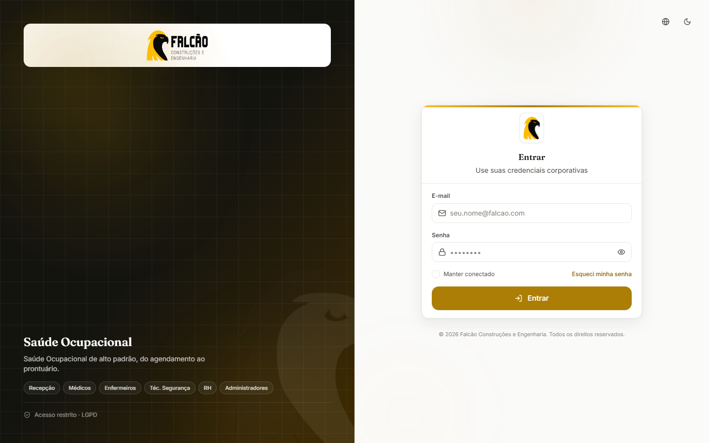
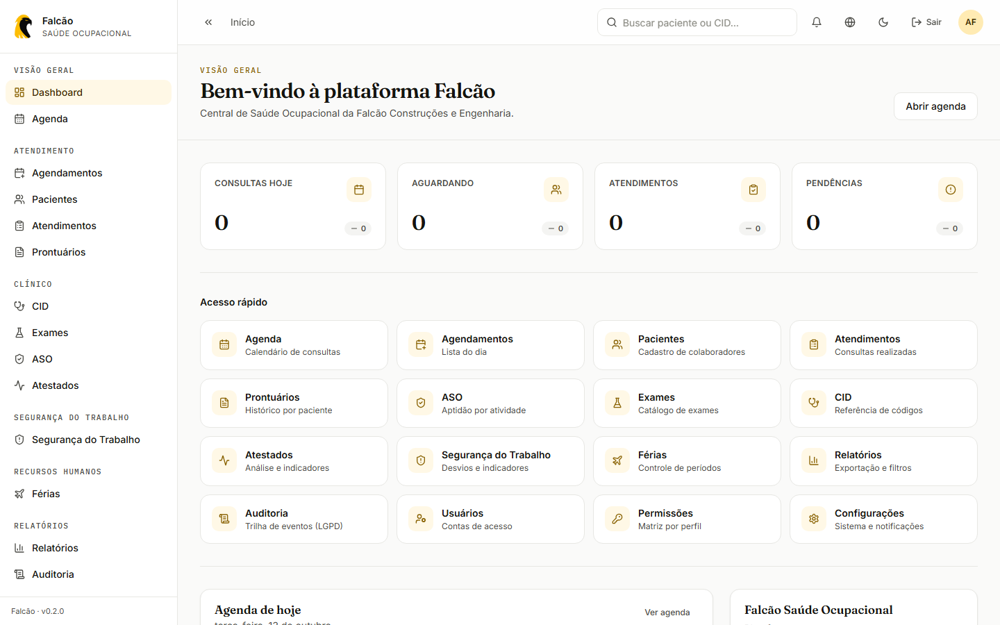
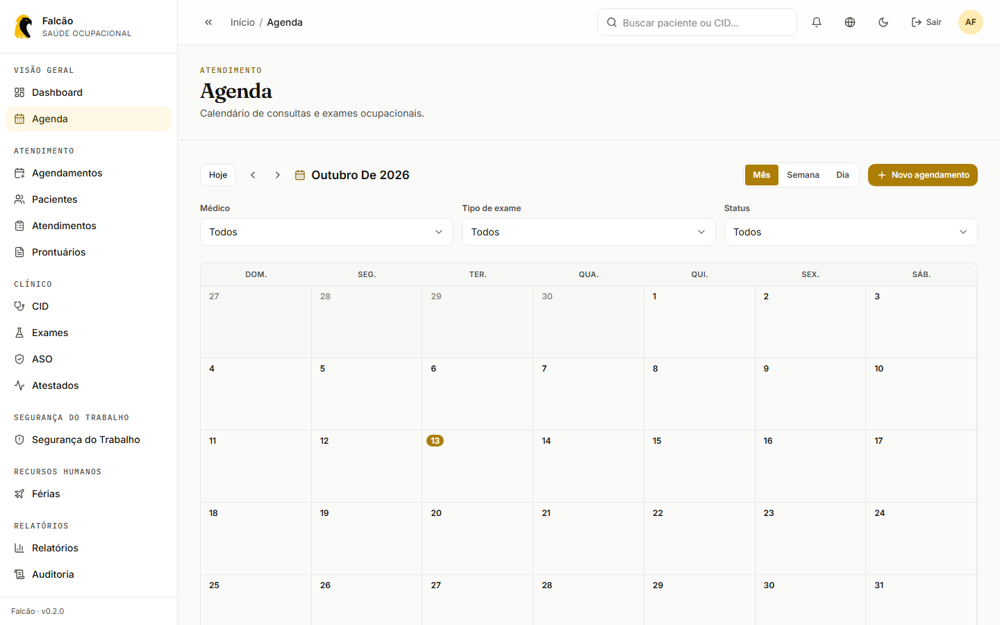
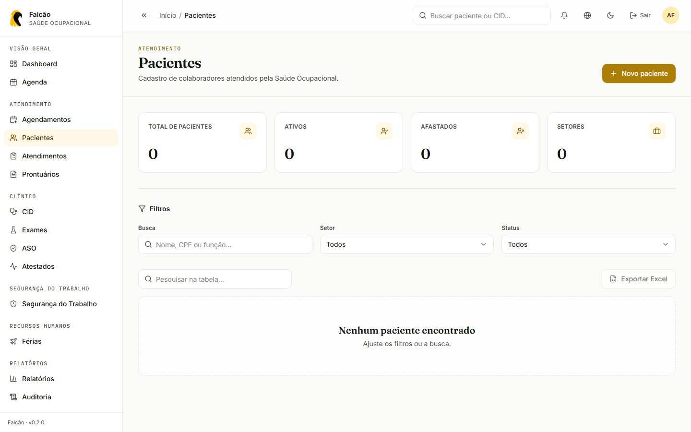
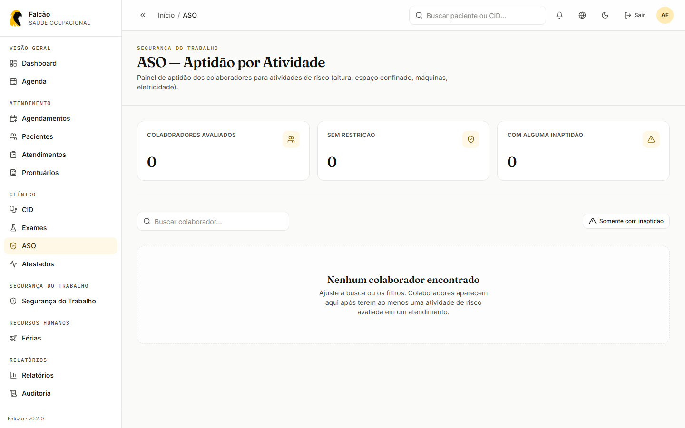
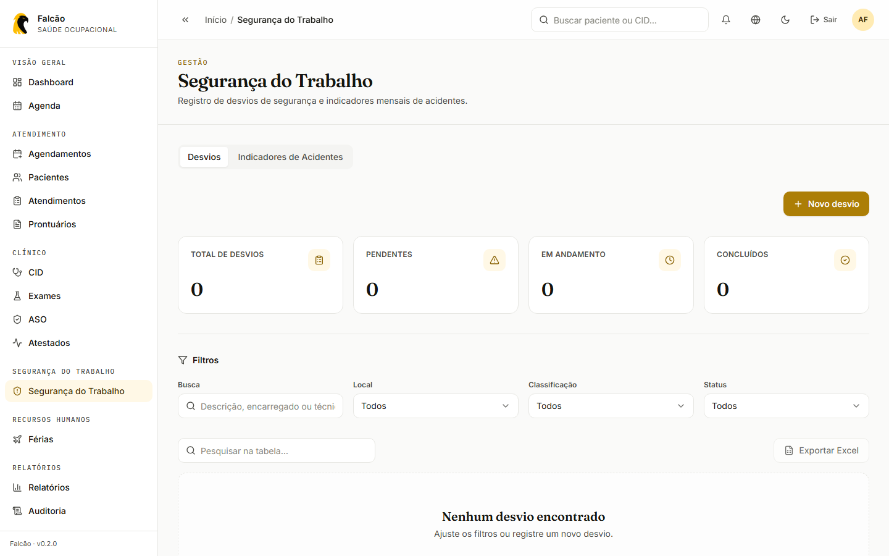
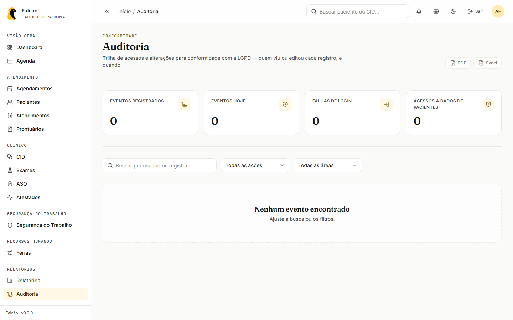
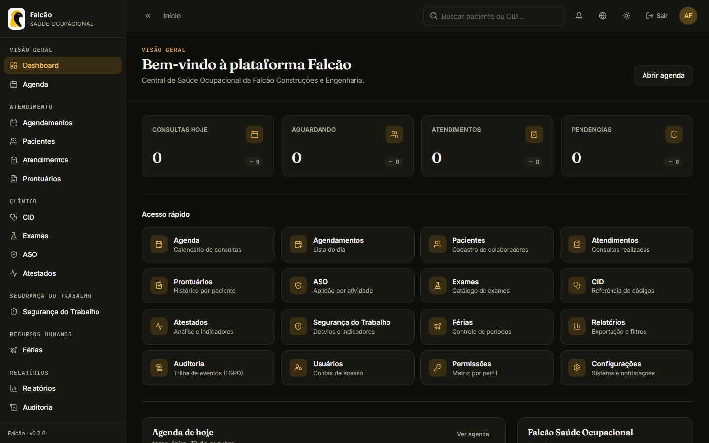

<p align="center">
  
</p>

<h1 align="center">🦅 Falcão · Saúde Ocupacional</h1>

<p align="center">
  <em>Saúde ocupacional de alto padrão, do agendamento ao prontuário.</em>
</p>

> Plataforma de gestão de Saúde Ocupacional para Recepção, Médicos, Enfermeiros, Técnicos de Segurança, RH e Administradores da Falcão Construções e Engenharia — 17 módulos, RBAC, auditoria LGPD e 3 idiomas (pt-BR, en-US, zh-CN).

<p align="center">
  <a href="https://github.com/mdevsec-code/falcao-saude-ocupacional/actions/workflows/ci.yml"></a>
  <a href="https://github.com/mdevsec-code/falcao-saude-ocupacional/actions/workflows/codeql.yml"></a>
  <a href="https://www.gitguard.com.br/mdevsec-code"></a>
  <a href="LICENSE"></a>
  <a href=".nvmrc"></a>
  
  
</p>

<p align="center">
  
  
  
  
  
  
  <br>
  
  
  
  
  
  
</p>

<p align="center">
  <a href="https://falcao-saude-ocupacional-eta.vercel.app"><strong>Ver demonstração no ar →</strong></a>
</p>

Aplicação web enterprise, modular, tipada e testada, para uso diário na
gestão de saúde e segurança ocupacional da Falcão Construções e Engenharia.
Construída com **React 18 + TypeScript + Vite + TailwindCSS + Radix UI +
TanStack Query + Axios + Zod + React Hook Form + Framer Motion + i18next +
MSW + Vitest**, com backend real em **NestJS + Prisma + PostgreSQL**
(`server/`).

---

## 📑 Sumário

- [📸 Telas](#-telas)
- [✨ Recursos](#-recursos)
- [🛠️ Stack](#️-stack)
- [🏗️ Arquitetura](#️-arquitetura)
- [🚀 Getting Started](#-getting-started)
- [📂 Project Structure](#-project-structure)
- [📍 Roadmap](#-roadmap)
- [🤝 Como contribuir](#-como-contribuir)
- [🛡️ Segurança](#️-segurança)
- [📜 Licença](#-licença)

---

## 📸 Telas

<p align="center">
  
</p>

|                                               Dashboard                                                |                                Agenda                                 |
| :----------------------------------------------------------------------------------------------------: | :-------------------------------------------------------------------: |
|  |      |
|                                             **Pacientes**                                              |                                **ASO**                                |
|                                  |  |
|                                       **Segurança do Trabalho**                                        |                         **Auditoria (LGPD)**                          |
|                     |   |

<details>
<summary>Tema escuro</summary>
<br>

</details>

> Telas capturadas com a API simulada (MSW) e a conta de demonstração local.

---

## ✨ Recursos

- **17 módulos operacionais**: Dashboard, Agenda, Agendamentos, Pacientes,
  Atendimentos, Prontuários, CID (catálogo + cadastro manual), Exames, ASO
  (aptidão por atividade de risco), Relatórios, Atestados, Férias, Segurança
  do Trabalho (desvios + indicadores de acidentes NBR 14280), Usuários,
  Permissões, Configurações e Auditoria (trilha LGPD)
- **Backend real** (`server/`, NestJS + Prisma + PostgreSQL) — auth JWT,
  RBAC por perfil, auditoria persistida; ver [`server/README.md`](server/README.md)
- **Design System próprio** baseado em tokens (CSS variables) com light/dark
  mode cuidado nas duas direções, não só invertido
- **Autenticação & RBAC** com `RequireAuth`, `RequirePermission` (bloqueio
  por rota, não só esconder o link), gate declarativo `<Can>` e 6 perfis
- **Camada HTTP** central (Axios com interceptors + `ApiError` normalizado)
- **Mock de API** (MSW) cobrindo todos os 17 módulos — permite rodar o
  frontend inteiro sem backend, útil para demo e desenvolvimento
- **Validação tipada** com Zod em formulários e contratos, mensagens
  traduzidas nos 3 idiomas
- **Internacionalização completa** com `react-i18next` — pt-BR, en-US e
  zh-CN, carregados automaticamente por `import.meta.glob`
- **Acessibilidade AA** (Radix UI Primitives + jsx-a11y)
- **Animações** com Framer Motion — indicador de navegação ativo animado,
  transições de página, entrada escalonada de listas
- **CI** com lint + typecheck + test + build
- **Deploy** em Vercel, Netlify, Azure Static Web Apps e Docker

---

## 🛠️ Stack

| Categoria       | Ferramenta                                    |
| --------------- | --------------------------------------------- |
| Build           | Vite 5 + TypeScript 5.6 strict                |
| UI              | React 18 + React Router v7                    |
| Estilo          | Tailwind CSS 3 (tokens via CSS variables)     |
| Componentes     | Radix UI Primitives                           |
| Ícones          | Lucide React                                  |
| Animações       | Framer Motion                                 |
| Estado servidor | TanStack Query 5                              |
| Estado cliente  | Zustand 4 (com persistência)                  |
| Formulários     | React Hook Form 7 + Zod                       |
| HTTP            | Axios 1                                       |
| Mock API        | MSW 2                                         |
| Toast           | Sonner                                        |
| i18n            | i18next 23 + react-i18next 15                 |
| Testes          | Vitest 2 + React Testing Library + jsdom      |
| Lint/Format     | ESLint 8 + Prettier 3 (+ tailwind plugin)     |
| Commits         | Husky 9 + lint-staged 15 + commitlint 19      |
| CI/CD           | GitHub Actions (CI + CodeQL)                  |
| Deploy          | Vercel · Netlify · Azure SWA · Docker (Nginx) |

---

## 🏗️ Arquitetura

Clean Architecture em camadas, com **feature-first** dentro de `src/`. Cada
módulo em `features/` segue o mesmo padrão interno: `types.ts` (schema Zod +
conversões), `services/*.api.ts`, `hooks/use*.ts` (React Query),
`components/` (tabela, filtros, diálogo criar/editar, diálogo excluir),
`pages/*.tsx`.

```
src/
├── app/              # Bootstrap, Providers, Router, error boundaries
├── assets/           # Logo, ilustrações
├── components/       # DS primitivos (ui/...), layout, feedback, common, error
├── config/           # env (Zod), features, brand
├── constants/        # routes, roles, permissions, status, i18n
├── features/         # auth, dashboard, agenda, appointments, patients,
│                      # attendances, records, cid, exams, aso, reports,
│                      # atestados, ferias, seguranca, users, permissions,
│                      # settings, audit, profile
├── hooks/            # useDebounce, useDisclosure, useMediaQuery, useTheme, useCountUp
├── i18n/             # i18next + locales (pt-BR, en-US, zh-CN)
├── services/         # http/ (cliente Axios), msw/ (mock de API — fixtures + handlers)
├── store/            # Stores globais Zustand (auth, ui, notification)
├── styles/           # tokens, reset, tailwind
├── test/             # setup, render, mocks
├── types/            # api, auth, domain, env
├── utils/            # cn, format, assert, delay, id, result, locale
└── validators/       # Zod schemas compartilhados (common, auth)

server/               # API real — NestJS + Prisma + PostgreSQL
├── prisma/           # schema.prisma, seed.ts
└── src/               # um módulo Nest por recurso, mesmo nome do
                        # equivalente em src/services/msw/handlers/
```

Para a visão completa do frontend, veja [`docs/architecture.md`](docs/architecture.md).
Para a API real, veja [`server/README.md`](server/README.md).

---

## 🚀 Getting Started

### Pré-requisitos

- **Node.js 20.11+** (veja [`.nvmrc`](.nvmrc))
- **npm 10+** (ou pnpm/yarn compatível)
- Corepack habilitado (para Husky):
  ```bash
  corepack enable
  ```

### Instalação

```bash
# 1. Clone o repositório
git clone https://github.com/mdevsec-code/falcao-saude-ocupacional.git
cd falcao-saude-ocupacional

# 2. Instale dependências
npm install

# 3. Inicialize o service worker do MSW
npm run msw:init

# 4. Copie .env.example para .env.local (opcional)
cp .env.example .env.local
```

> Isso roda só o frontend, com a API mockada (MSW) — suficiente para
> desenvolver/demonstrar qualquer tela. Para rodar contra o backend real
> (NestJS + Prisma + PostgreSQL) em vez do mock, siga
> [`server/README.md`](server/README.md) e depois ajuste
> `VITE_API_URL`/`VITE_ENABLE_MSW=false` abaixo.

### Variáveis de ambiente

| Var                   | Default                     | Descrição                         |
| --------------------- | --------------------------- | --------------------------------- |
| `VITE_API_URL`        | `http://localhost:5173/api` | URL base da API                   |
| `VITE_ENABLE_MSW`     | `false`                     | Habilita o mock de API no browser |
| `VITE_DEFAULT_LOCALE` | `pt-BR`                     | Locale inicial do i18n            |
| `VITE_APP_NAME`       | `Falcão Saúde Ocupacional`  | Nome exibido em `<title>` e meta  |
| `VITE_SENTRY_DSN`     | —                           | DSN do Sentry (opcional)          |
| `VITE_LOG_LEVEL`      | `info`                      | Nível mínimo de log               |

> Schema validado em runtime com Zod em [`src/config/env.ts`](src/config/env.ts).

### Scripts

```bash
npm run dev           # Vite dev server (http://localhost:5173)
npm run build         # tsc -b + vite build
npm run preview       # Serve a build de produção local

npm run lint          # ESLint
npm run lint:fix      # ESLint --fix
npm run format        # Prettier --write
npm run format:check  # Prettier --check
npm run typecheck     # tsc -b --noEmit
npm run test          # Vitest run
npm run test:watch    # Vitest watch
npm run coverage      # Vitest com v8 coverage
npm run validate      # typecheck + lint + format:check + test + build
```

### Acesso local (desenvolvimento)

O ambiente roda sem backend real (MSW mocka a API). Existe apenas uma conta
administrativa inicial — crie o restante da equipe pela tela de Usuários
depois de entrar:

| Email              | Senha         | Perfil        |
| ------------------ | ------------- | ------------- |
| `admin@falcao.com` | `changeme123` | Administrador |

> Credencial válida **apenas neste mock local** — não existe em produção.
> Após `npm install && npm run msw:init && npm run dev`, abra `/login` e entre
> com as credenciais acima. O MSW intercepta todas as requisições em dev.

---

## 📂 Project Structure

```
.
├── .editorconfig
├── .env.example
├── .eslintrc.cjs
├── .github/             # workflows, templates, CODEOWNERS, labeler
├── .husky/              # pre-commit, commit-msg
├── .lintstagedrc.json
├── .nvmrc
├── .prettierignore
├── .prettierrc
├── .vscode/             # extensions.json, settings.json
├── azure/               # staticwebapp.config.json
├── docker/              # nginx.conf
├── docs/                # architecture, api, deployment, roadmap, decisions
├── public/              # favicon, manifest, robots
├── server/              # API real (NestJS + Prisma + PostgreSQL) — ver server/README.md
├── src/                 # Aplicação frontend
├── Dockerfile
├── docker-compose.yml
├── LICENSE
├── netlify.toml
├── package.json
├── postcss.config.js
├── tailwind.config.ts
├── tsconfig.json
├── tsconfig.app.json
├── tsconfig.node.json
├── vercel.json
├── vite.config.ts
└── vitest.config.ts
```

---

## 📍 Roadmap

Etapas 1, 2, 4, 5 e 6 concluídas — os 17 módulos operacionais listados em
[Recursos](#-recursos) estão todos no ar (sobre MSW). Em andamento:

- **Etapa 3 — API real** — backend NestJS + Prisma cobre todos os módulos
  (controller + service + DTO), falta rodar a migration num Postgres real,
  apontar o frontend para a API (`VITE_ENABLE_MSW=false`) e adicionar
  OAuth2/refresh tokens
- **Etapa 7 — Observabilidade, LGPD, auditoria** — auditoria (LGPD) já em
  produção; faltam Sentry, OpenTelemetry, logs estruturados, SLOs
- **Etapa 8 — Mobile (PWA → React Native)** — não iniciada

Veja [`docs/roadmap.md`](docs/roadmap.md) para o detalhamento etapa a etapa
e [`server/README.md`](server/README.md) para o estado exato do backend.

---

## 🤝 Como contribuir

Leia [`CONTRIBUTING.md`](CONTRIBUTING.md) e os documentos auxiliares em
[`docs/contributing/`](docs/contributing/):

- [Branches (Git Flow)](docs/contributing/branches.md)
- [Commits (Conventional Commits)](docs/contributing/commits.md)
- [Pull Requests](docs/contributing/pull-requests.md)

---

## 🛡️ Segurança

Veja [`SECURITY.md`](SECURITY.md) para política de reportar vulnerabilidades.

---

## 📜 Licença

[MIT](LICENSE) © Falcão Construções e Engenharia.

---

<p align="center">
  <sub>Feito para a <strong>Falcão Construções e Engenharia</strong> · parte da família de sistemas Falcão, ao lado do <a href="https://github.com/mdevsec-code/falcao-ERP-suprimentos-master">ERP de Suprimentos</a></sub>
</p>
